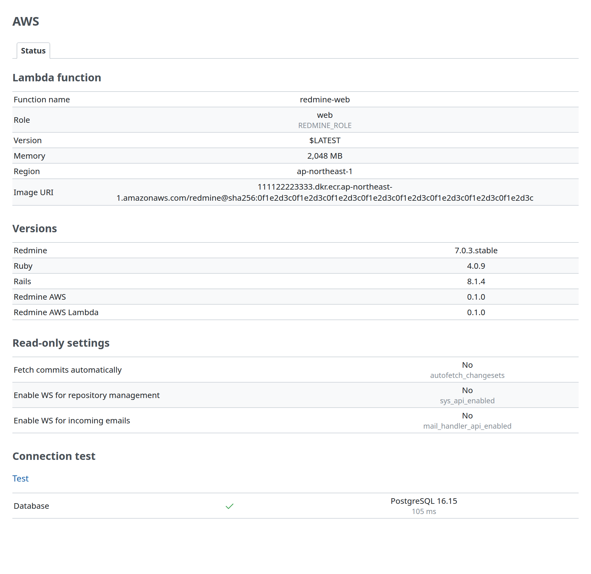
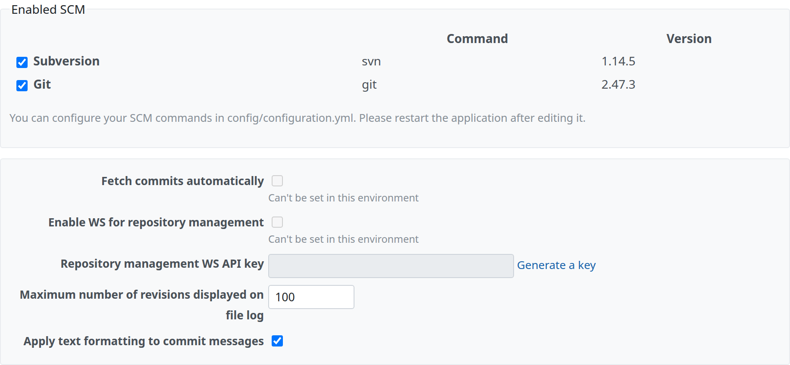

# Administration pages

This page describes what Redmine AWS Lambda shows in Redmine's administration: the Lambda function and the read-only settings on the "Status" tab, and the Redmine settings that it fixes on Lambda. The "AWS" item of the administration menu and the "Status" tab belong to [Redmine AWS](https://redmine-kit.github.io/redmine_aws/admin.html), which describes the menu, the other values of the tab and the connection test.

The specifications in this page were checked against official information and the Redmine 7.0.3 source as of 2026-11-08. Sources are in [sources.md](https://redmine-kit.github.io/serverless/sources.html).

## Status

The plugin adds two sections to the "Status" tab of Redmine AWS (Administration › AWS › Status): the Lambda function before the versions, and the read-only settings after them. Only administrators can open the tab, and it shows no secrets.

| Item | Contents | Source |
| --- | --- | --- |
| Lambda function | Function name, role (`REDMINE_ROLE`), version, memory, Region, image URI. "-" for a value that is not set | Lambda environment variables (`AWS_LAMBDA_FUNCTION_NAME`, etc.), and `REDMINE_IMAGE`: the function's environment variable that the deployment sets to the URI of the function's image by digest (`<account>.dkr.ecr.<Region>.amazonaws.com/<repository>@sha256:<digest>`; Serverless sets it from its `ImageUri` parameter) |
| Read-only settings | The settings fixed to disabled in "Redmine settings that cannot work on Lambda" below and their current values (Yes/No). "No data to display" outside Lambda | Values set by the plugin |

## Redmine settings that cannot work on Lambda

Standard Redmine settings that do not work on Lambda, or that this design does not leave open, are fixed to disabled by the plugin, and Redmine's settings page shows this.

| Setting (name in the Redmine UI) | Page | How the plugin handles it | Reason |
| --- | --- | --- | --- |
| Enabled SCM (`enabled_scm`) | Administration › Settings › Repositories | Only Subversion and Git are listed and can be enabled; the other types are not listed. Projects can have Subversion and Git repositories | The image of Serverless has only the Subversion and Git clients. A Subversion repository can be remote (`https://`, `svn://`), and Redmine reads it with `svn` without keeping a copy. Redmine reads a Git repository from a local bare repository with `git`; on Lambda only `/tmp` is writable, and a repository under `/tmp` is lost when the execution environment stops. Where to keep Git repositories has not been decided ([Serverless lambda.md](https://redmine-kit.github.io/serverless/lambda.html#repositories)) |
| Fetch commits automatically (`autofetch_changesets`) | Same as above | Fixed to disabled | With it, Redmine fetches new commits while it shows the repository page, so the page waits for the client, and a first fetch of a large repository may not finish within the web function's timeout (60 seconds). Commits are fetched with `rake redmine:fetch_changesets` on `redmine-task` instead ([Serverless lambda.md](https://redmine-kit.github.io/serverless/lambda.html#repositories)) |
| Enable WS for repository management (`sys_api_enabled`) | Same as above | Fixed to disabled | This web service is for `reposman.rb`, which creates repositories on the server's disk, and for hooks that ask Redmine to fetch commits. Lambda has no disk to keep repositories on, and fetching is done by the task above, so it is not left open |
| Enable WS for incoming emails (`mail_handler_api_enabled`) | Administration › Settings › Incoming emails | Fixed to disabled | Email is received by SES and imported by `redmine-task` ([mail.md](https://redmine-kit.github.io/serverless/mail.html#receiving); [Redmine AWS SES](https://redmine-kit.github.io/redmine_aws_ses/)). A web service that lets anyone push email in over HTTP is not left open |

| Item | Details |
| --- | --- |
| Fixing the values | The plugin replaces the readers of the settings above (`Setting.enabled_scm`, `Setting.autofetch_changesets?`, `Setting.sys_api_enabled?`, `Setting.mail_handler_api_enabled?`) so they return the fixed values, and `Setting.enabled_scm` returns the saved value without the types other than Subversion and Git. Together with the checkbox helper below, this is the plugin's only replacement of Redmine code; when Redmine is upgraded, check that these readers and the helper have not changed. Saving from the settings page does not change these values. Old values left in the database are not used, except the choice between Subversion and Git |
| Showing it on the page | On Redmine's settings page, the checkboxes of the settings above are disabled and unchecked, with the note "Can't be set in this environment". A helper that the plugin adds to the settings page (`SettingsController.helper`) wraps Redmine's `SettingsHelper#setting_check_box` for these settings; the Repositories and Incoming emails tabs have no hook inside their forms. The repository types other than Subversion and Git are removed from Redmine's list of repository types on Lambda (`Redmine::Scm::Base.delete`), so neither the settings page nor the repository form of a project offers them, and Redmine does not create them (`Repository.factory`). The page templates are not replaced, and no JavaScript is added. Checked on 2026-11-11 with Redmine 7.0.3 (the plugin's tests) |
| Condition | The values are fixed only on Lambda (when `REDMINE_ROLE` is set). In local tests and environments other than Lambda, standard Redmine behavior applies |
| "Information" on the administration page | Redmine's standard checks (whether the file storage directory is writable, whether the job queue was changed from the default, ImageMagick, Ghostscript, Pandoc, etc.) are expected to pass in Serverless (storage is `/tmp/redmine/files`, jobs use `:sqs`) |

## Permissions

The pages call no AWS API of this plugin's own; see [iam.md](iam.md).

## Tests

The sections of the Status tab and the settings page have Redmine functional tests ([testing.md](https://redmine-kit.github.io/serverless/testing.html#administration-pages)).

The screenshots on this page are taken with `bin/screenshots` (headless Chromium in Docker, with Redmine's test data). Run it after changing a screen.
