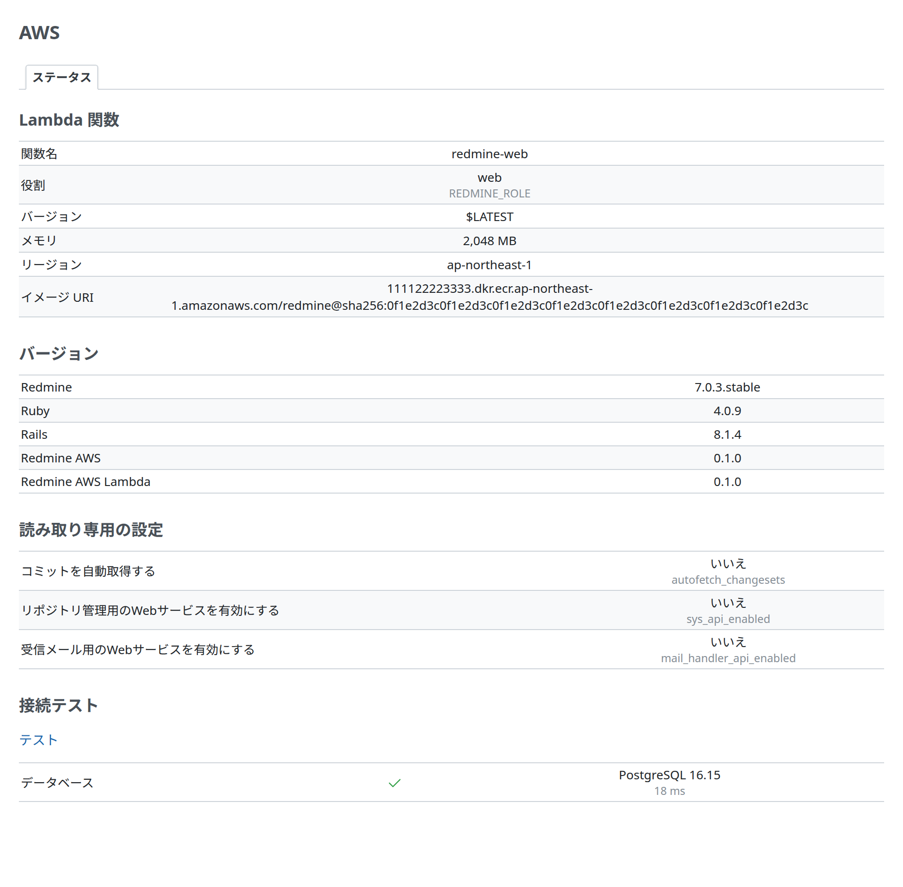
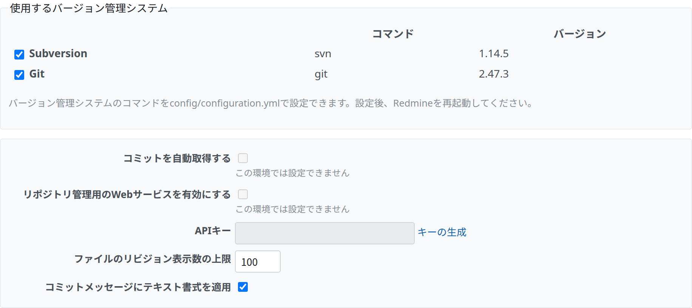

# 管理画面

Redmine AWS Lambda が Redmine の管理画面に表示するもの (「ステータス」のタブの Lambda 関数と読み取り専用の設定) と、Lambda で固定する Redmine の設定です。管理メニューの「AWS」の項目と「ステータス」のタブは [Redmine AWS](https://redmine-kit.github.io/redmine_aws/ja/admin.html) のもので、メニュー、タブのほかの値、接続テストはそちらで説明しています。

この資料の仕様は、2026-11-08 時点の公式の情報と、Redmine 7.0.3 のソースで確認したものです。出典は [sources.md](https://redmine-kit.github.io/serverless/ja/sources.html) にあります。

## ステータス

プラグインは、Redmine AWS の「ステータス」のタブ (「管理」›「AWS」›「ステータス」) に 2 つの項目を追加します。バージョンの前に Lambda 関数、後に読み取り専用の設定です。タブを開けるのはシステム管理者だけで、シークレットは表示しません。

| 項目 | 内容 | 取得元 |
| --- | --- | --- |
| Lambda 関数 | 関数名、役割 (`REDMINE_ROLE`)、バージョン、メモリ、リージョン、イメージ URI。設定されていない値は「-」 | Lambda の環境変数 (`AWS_LAMBDA_FUNCTION_NAME` など)。`REDMINE_IMAGE` は、デプロイが関数の環境変数に設定する、関数のイメージの digest 付きの URI (`<アカウント>.dkr.ecr.<リージョン>.amazonaws.com/<リポジトリ>@sha256:<digest>`。Serverless はパラメーター `ImageUri` から設定する) |
| 読み取り専用の設定 | 下の「Lambda で使えない Redmine の設定」のうち、無効に固定する設定と、現在の値 (はい/いいえ)。Lambda 以外では「表示するデータがありません」 | プラグインが決めた値 |

## Lambda で使えない Redmine の設定

Redmine の標準の設定のうち、Lambda 上では動かないものや、この設計では開けておかないものは、プラグインが無効に固定し、Redmine の設定の画面にもそう表示します。

| 設定 (Redmine の画面の名前) | 画面 | プラグインの扱い | 理由 |
| --- | --- | --- | --- |
| 使用するバージョン管理システム (`enabled_scm`) | 「管理」›「設定」›「リポジトリ」 | Subversion と Git だけを表示し、有効にできる。ほかの種類は表示しない。プロジェクトには Subversion と Git のリポジトリを作成できる | Serverless のイメージには、Subversion と Git のクライアントだけがある。Subversion のリポジトリはリモート (`https://`、`svn://`) でもよく、Redmine はコピーを持たずに `svn` で読む。Git のリポジトリは、Redmine がローカルのベアリポジトリを `git` で読む。Lambda で書き込めるのは `/tmp` だけで、`/tmp` に置いたリポジトリは実行環境が停止すると失われる。Git のリポジトリの保存先は未決定 ([Serverless の lambda.md](https://redmine-kit.github.io/serverless/ja/lambda.html#repositories)) |
| コミットを自動取得する (`autofetch_changesets`) | 同上 | 無効に固定する | 有効にすると、Redmine はリポジトリの画面を表示するときに新しいコミットを取得するので、画面がクライアントの処理を待つ。大きなリポジトリの最初の取得は、web の関数のタイムアウト (60 秒) までに終わらないことがある。コミットは代わりに `redmine-task` の `rake redmine:fetch_changesets` で取得する ([Serverless の lambda.md](https://redmine-kit.github.io/serverless/ja/lambda.html#repositories)) |
| リポジトリ管理用のWebサービスを有効にする (`sys_api_enabled`) | 同上 | 無効に固定する | この Web サービスは、サーバーのディスクにリポジトリを作成する `reposman.rb` と、Redmine にコミットの取得を依頼するフックのためのもの。Lambda にはリポジトリを置くディスクがなく、取得は上のタスクで行うので、開けない |
| 受信メール用のWebサービスを有効にする (`mail_handler_api_enabled`) | 「管理」›「設定」›「受信メール」 | 無効に固定する | メールは SES で受けて `redmine-task` が取り込む ([mail.md](https://redmine-kit.github.io/serverless/ja/mail.html#receiving)、[Redmine AWS SES](https://redmine-kit.github.io/redmine_aws_ses/ja/))。外から HTTP でメールを送り込める Web サービスを開けない |

| 項目 | 内容 |
| --- | --- |
| 値を固定する | プラグインが、上の設定の読み出し (`Setting.enabled_scm`、`Setting.autofetch_changesets?`、`Setting.sys_api_enabled?`、`Setting.mail_handler_api_enabled?`) を差し替えて、決めた値を返します。`Setting.enabled_scm` は、保存した値から Subversion と Git 以外を除いて返します。プラグインが Redmine の処理を差し替えるのは、ここと下のチェックボックスのヘルパーだけです。Redmine のバージョンアップでは、これらの読み出しとヘルパーが変わっていないかを確認します。設定の画面から保存しても、これらの値は変わりません。データベースに古い値が残っていても、使われません。Subversion と Git の選択だけは、保存した値を使います |
| 画面に表示する | Redmine の設定の画面で、上の設定のチェックボックスを押せない状態 (オフ) にし、「この環境では設定できません」と添えます。プラグインが設定の画面に追加するヘルパー (`SettingsController.helper`) が、これらの設定について Redmine の `SettingsHelper#setting_check_box` をラップします。「リポジトリ」と「受信メール」のタブには、フォームの中のフックがないためです。Subversion と Git 以外のリポジトリの種類は、Lambda 上では Redmine のリポジトリの種類の一覧から外します (`Redmine::Scm::Base.delete`)。そのため、設定の画面にもプロジェクトのリポジトリのフォームにも表示されず、Redmine はそれらを作成しません (`Repository.factory`)。画面のテンプレートは差し替えず、JavaScript も追加しません。2026-11-11 に Redmine 7.0.3 で確認しました (プラグインのテスト) |
| 条件 | Lambda 上 (`REDMINE_ROLE` があるとき) だけ固定します。ローカルのテストや、Lambda 以外の環境では、Redmine の標準のままです |
| 管理画面の「情報」 | Redmine の標準の確認 (ファイルの保存先に書き込めるか、ジョブのキューをデフォルトから変えたか、ImageMagick、Ghostscript、Pandoc など) は、Serverless で通る見込みです (保存先は `/tmp/redmine/files`、ジョブは `:sqs`) |

## 権限

画面は、このプラグイン自身の AWS の API を呼びません。[iam.md](iam.md) を参照してください。

## テスト

ステータスのタブの項目と設定の画面には、Redmine の機能テストがあります ([testing.md](https://redmine-kit.github.io/serverless/ja/testing.html#administration-pages))。

このページのスクリーンショットは、`bin/screenshots` で撮影します (Docker のヘッドレス Chromium と、Redmine のテストデータ)。画面を変更したら実行します。
